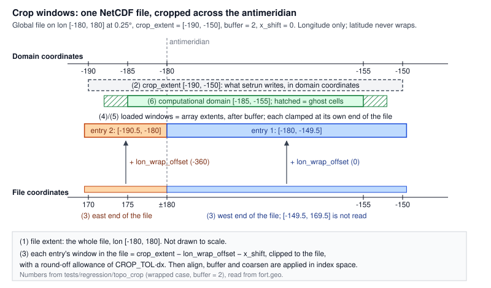

# Topography crop windows

*Status: reference. Describes `master` once clawpack/geoclaw#762, #763 and the
PR A in `topo_input_roadmap.md` §2.8 have merged. Checked against branch
`topo-crop-frame` at `2b8d3c9e`, with the numbers below taken from runs of
`tests/regression/topo_crop`.*

Several different rectangles describe "which part of a topography file is
used". They are in different coordinate frames, are set by different people
(the user, the writer, the reader), and only some of them appear in
`topo.data`. Mixing them up was behind the questions in §2.8 of the roadmap,
so this page names each one and says where it lives. dtopo and met follow the
same rules where they implement cropping. dtopo crop in Fortran is
mandli/geoclaw#15, and met has its own crop line.

## Two coordinate frames

- **File coordinates**: the numbers stored in the file.
- **Domain coordinates**: where GeoClaw puts the data:

  ```
  x_domain = x_file + lon_wrap_offset + x_shift
  y_domain = y_file + y_shift
  ```

  `x_shift`/`y_shift` are user attributes of the `Topography`. `lon_wrap_offset`
  is 0 or ±360, set by `TopographyData.write` for a netCDF crop that crosses
  the antimeridian, and written to the entry's descriptor. ASCII files never
  wrap.

Everything the user writes is in domain coordinates. Only the readers ever
work in file coordinates.

## The windows

| # | Window | Frame | Set by | Where it lives |
|---|---|---|---|---|
| 1 | **File extent**: the whole file | file | the file | ASCII header; netCDF coordinate variables. No `Topography` attribute. |
| 2 | **`crop_extent`**: the requested crop | domain | the user | `Topography.crop_extent`; the `# crop_extent` line of each `topo.data` entry; Fortran `topo_crop_extent` |
| 3 | **Entry window in the file**: the crop for one `topo.data` entry, in that file's coordinates | file | derived | Not stored. Fortran computes `crop_extent − lon_wrap_offset − shift`, clipped to the file. The netCDF inspectors' `crop_bounds` holds the same thing for Python's own checks, but it is not written to `topo.data`. |
| 4 | **Loaded window**: window 3 after align, buffer and coarsen, in index space | file indices | derived | Fortran `topo_i_start`/`mxtopo` etc.; Python `crop_indices` |
| 5 | **Array extent**: the bounds of the data actually held | domain | derived | `Topography.extent`; Fortran `xlowtopo`/`xhitopo` (and `fort.geo` for netCDF) |
| 6 | **Computational domain + ghost cells** | domain | the user (`clawdata`) | Used as the netCDF read window only when there is **no** crop. |

The picture shows all six for one netCDF file cropped across the antimeridian:



## How a crop is applied

The same steps run in Python (`Topography.read`) and Fortran
(`read_topo_settings` for types 2/3, `read_topo_file` for type 4):

1. **Compare in a common frame.** The crop (window 2) is compared with the
   file's points after the shift and offset. Python shifts the coordinates;
   Fortran subtracts the shift and offset from the crop. These are
   equivalent.
2. **Select the points inside**, allowing `CROP_TOL·dx` of round-off at each
   edge, so a crop written on a grid line keeps that line. Window 3 is the
   result. `CROP_TOL` is `1e-6` and is the same constant in
   `coordinate_tools` and `topo_module.f90`.
3. **align → buffer → coarsen**, in index space, giving window 4. `buffer`
   counts coarsened points: it adds `buffer·coarsen` native points per side,
   clamped to the file.
4. **Shift into the domain.** Window 5 is what remains, in domain
   coordinates.

Rules that hold for every topo type:

- A `crop_extent` its file does not cover is an error at `make data`
  (clawpack/geoclaw#763). "Covered" allows half a cell beyond the outermost
  points, so a crop at a tile's cell edges is accepted. If a crop reaches
  Fortran missing its file (a hand-edited `topo.data`), Fortran stops.
- With no crop, an ASCII file is read whole. A netCDF file is read over the
  computational domain plus ghost cells (window 6), to avoid loading a global
  DEM. Python reads the whole file in both cases.
- A crop given in the *wrapped* spelling (`[170, -170]`) is rejected. Write it
  continuously (`[170, 190]` or `[-190, -170]`).

## Across the antimeridian

For a netCDF file under a geographic run, a `crop_extent` that runs past the
file's longitude range becomes **one `topo.data` entry per side**. Both entries
carry the same `crop_extent` and differ only in `lon_wrap_offset`. Fortran
clips each one to its own end of the file. In the picture (from
`tests/regression/topo_crop`, file at 0.25°, `crop_extent = [-190, -150]`):

| Entry | `lon_wrap_offset` | Window in the file | Loaded, buffer 0 | Loaded, buffer 2 |
|---|---|---|---|---|
| 1 | 0 | `[-180, -150]` | `[-180, -150]`, 121 points | `[-180, -149.5]`, 123 points |
| 2 | −360 | `[170, 180]` | `[-190, -180]`, 41 points | `[-190.5, -180]`, 43 points |

Two consequences worth knowing:

- **The buffer does not cross the seam.** Each entry's buffer is clamped at its
  own end of the file, so the two entries meet at the seam but neither reaches
  past it. For a node-registered global file like this one, both entries hold
  the seam column (`-180` and `180`), so they touch. For a cell-centred global
  file (GEBCO), neither reaches ±180 and a one-cell hole remains. That is
  roadmap §2.1, still open.
- **Python does not wrap yet.** `Topography.read` with the same crop returns only
  the part inside the file, with a warning. Returning one object across the
  seam that matches the entries above is roadmap §2.8, PR A2.

## ASCII and netCDF

The rule: the windowing logic and the names above apply to ASCII (types 2/3)
and netCDF (type 4) alike, wherever it makes sense. Any difference has to be
justified here. These are already shared:

- The names (`crop_extent`, `coarsen`, `buffer`, `align`, `x_shift`/`y_shift`)
  and the `topo.data` preprocessing lines.
- The coordinate frame.
- `CROP_TOL`.
- The coverage rule.
- The index arithmetic: Python's `_crop_indices` and Fortran's
  `apply_align_buffer_coarsen`.

Differences that remain (checked 2026-10-22 against `d6e579f8`):

| Difference | Justified? | Plan |
|---|---|---|
| **The antimeridian wrap is netCDF-only.** `lon_wrap_offset` is carried only in the netCDF descriptor, so an ASCII crop across the seam fails the coverage check. | No. Global geographic ASCII grids exist, and the wrap does not depend on the format. | Roadmap §2.8 PR B: make `lon_wrap_offset` a per-entry `topo.data` line for every type, and have the Fortran ASCII path subtract it as the netCDF path does. |
| **Fortran computes the window in two places.** ASCII uses index arithmetic from the header in `read_topo_settings` (`topo_i_start`, `mxtopo_full`). netCDF masks the actual coordinates in `read_topo_header`'s netCDF branch (locals `i_lo4`, `nbuf4`, `cf4`). | No. The tolerance and the align/buffer/coarsen routine are shared, but nothing tests that the two paths agree. | One Fortran routine, given coordinate arrays (built from the header for ASCII), used by both. |
| **`fort.geo` reports different windows.** It shows the whole-file header for ASCII and the loaded window for netCDF. | No. A test cannot read the ASCII window from it (`test_shifted_crop_is_in_domain_coordinates` checks values instead). | Report the loaded window for both, together with the shared routine above. |
| **With no crop**, Fortran reads a whole ASCII file but only the domain plus ghost cells of a netCDF file. | Yes. Memory only: a global DEM is never loaded in full, and the values used are the same. ASCII text has to be parsed anyway. | None. |

Python agrees for both formats apart from the wrap, which is roadmap §2.8 PR
A2. That PR should apply to every format that can wrap, so it depends on the
first row. Python reads only the window for netCDF but reads a whole ASCII
file and then crops, which is again a difference in memory use only.

## History

Before §2.8's PR A, netCDF crops were applied in file coordinates, before the
shift, in both Python and Fortran. ASCII crops were applied after it. `topo.data`
also carried each netCDF entry's window 3 as a descriptor `crop_bounds` line,
which Fortran used ahead of `crop_extent`. An old `topo.data` with that line now
stops with "Regenerate topo.data with 'make data'".
